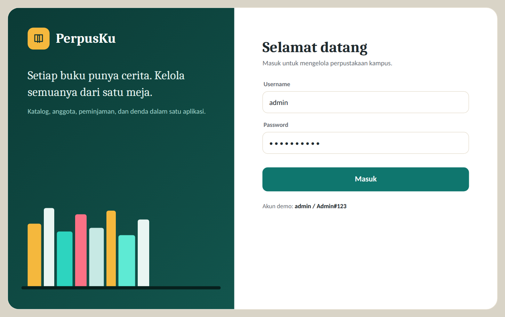
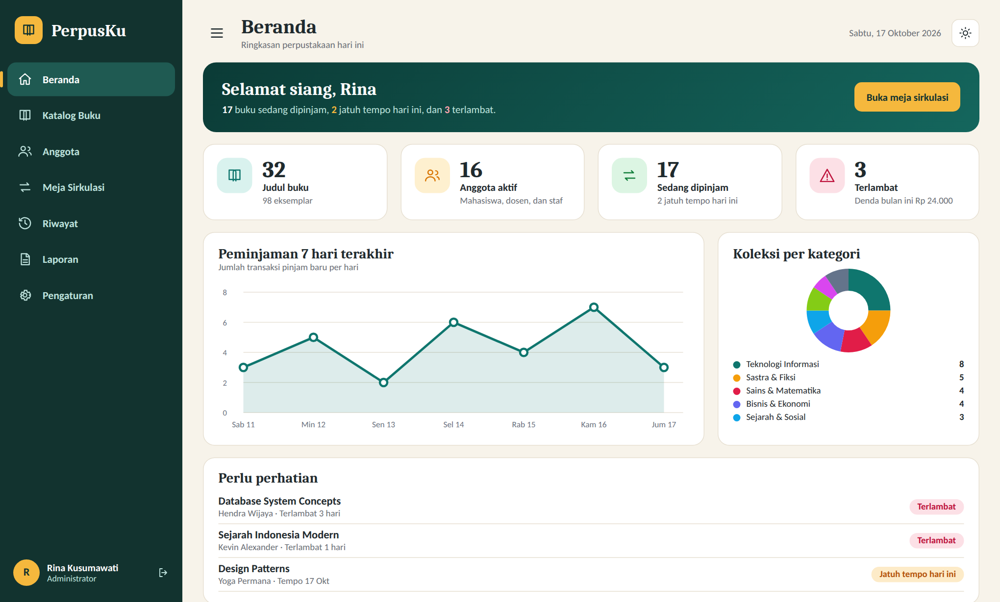
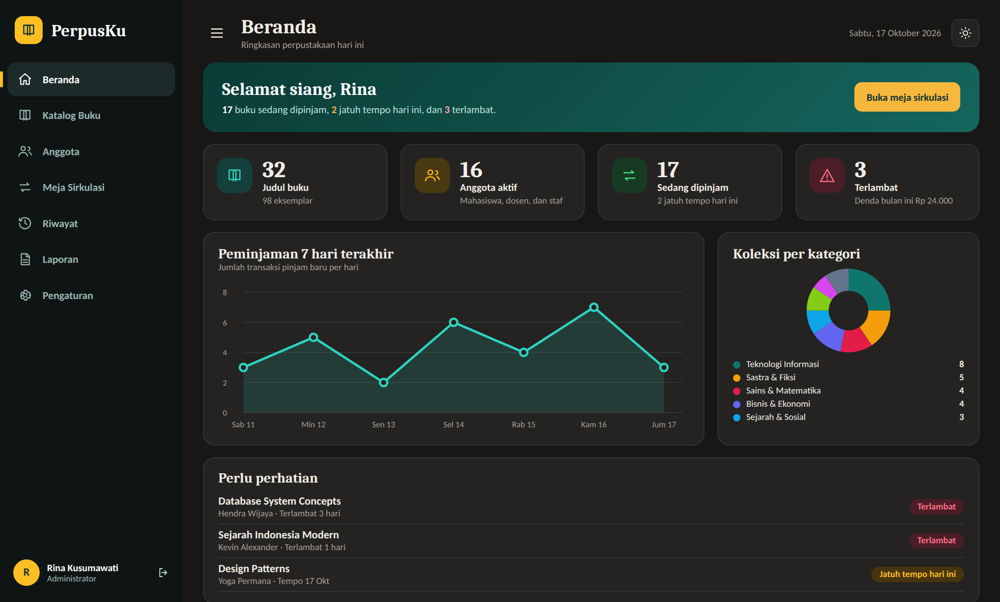

# PerpusKu

Sistem manajemen perpustakaan kampus untuk Windows — desktop WPF (.NET 9) dengan SQL Server LocalDB,
antarmuka bertema **Passport Travel UI** (kertas, stempel, tipografi typewriter), mode terang/gelap,
dasbor grafik, dan ekspor laporan PDF.

| Login | Dasbor (terang) | Dasbor (gelap) |
|---|---|---|
|  |  |  |

## Fitur

- **Katalog buku** — CRUD, pencarian, filter kategori/rak, stok otomatis
- **Keanggotaan** — CRUD anggota, kartu anggota, status aktif/nonaktif
- **Sirkulasi** — peminjaman, perpanjangan, pengembalian dengan denda otomatis (transaksi SQL atomik)
- **Dasbor** — statistik + grafik LiveCharts, warna mengikuti tema
- **Laporan PDF** — QuestPDF, gaya cetak resmi (tetap terang saat print)
- **Tema** — terang/gelap, bisa diganti dari halaman Pengaturan (preferensi disimpan di `%APPDATA%\PerpusKu\prefs.json`)
- **Hak akses** — Admin dan Pengunjung, diperiksa di lapisan repository

## Teknologi

| Layer | Pilihan |
|---|---|
| Runtime | .NET 9 (`net9.0-windows`), WPF |
| Arsitektur | MVVM — Views → ViewModels → Services → Repositories → SQL |
| Database | SQL Server / LocalDB via ADO.NET (Microsoft.Data.SqlClient), query berparameter |
| Grafik | LiveChartsCore.SkiaSharpView.WPF |
| PDF | QuestPDF (lisensi Community) |
| Font | Courier Prime (SIL Open Font License, embedded) |
| Ikon | Geometri Lucide (ISC) di-embed sebagai `Path` — tanpa emoji |
| Keamanan | Password PBKDF2-SHA256 + salt |

## Struktur folder

```
PerpusKu/
├── PerpusKu.sln
├── publish.bat                  ← buat PerpusKu.exe mandiri (self-contained)
├── docs/                        ← PRD, ERD, UML, mockup UI, screenshot
├── database/                    ← skrip SQL 01–05 (dijalankan otomatis saat aplikasi pertama kali jalan)
└── src/PerpusKu.App/
    ├── Themes/                  ← LightTheme, DarkTheme, Tokens, Styles, Icons (Lucide)
    ├── Views/                   ← LoginWindow, ShellWindow, Pages/, Dialogs/
    ├── ViewModels/
    ├── Services/                ← ThemeService, ReportService, auth, dsb.
    ├── Repositories/
    ├── Converters/
    └── Fonts/                   ← Courier Prime .ttf
```

## Menjalankan dari source

Prasyarat: **.NET SDK 9** dan **SQL Server Express LocalDB**
(Visual Studio Installer → *Individual components* → *SQL Server Express LocalDB*).

```powershell
git clone <repo-url> PerpusKu
cd PerpusKu
dotnet run --project src\PerpusKu.App
```

Database `PerpusKu_DB` dibuat dan di-seed otomatis saat login pertama (butuh hak CREATE DATABASE
sekali; atau jalankan manual skrip `database/01…05` di SSMS).

### Akun demo

| Peran | Username | Password |
|---|---|---|
| Admin | `admin` | `Admin#123` |
| Pengunjung | `tamu` | `Tamu#123` |

> Ganti password demo sebelum dipakai sungguhan (Pengaturan → Akun saya).

## Membuat .exe untuk dibagikan

```powershell
.\publish.bat          # hasil di folder publish\
```

atau manual:

```powershell
dotnet publish src\PerpusKu.App -c Release -r win-x64 --self-contained true `
  -p:PublishSingleFile=true -p:IncludeNativeLibrariesForSelfExtract=true -o publish
```

Bagikan **seluruh isi folder `publish`** (di-zip), bukan hanya `PerpusKu.exe` — folder `Database`
dan `appsettings.json` harus ikut. Komputer tujuan tidak perlu .NET, tetapi tetap perlu LocalDB
atau SQL Server.

## Pakai SQL Server biasa (bukan LocalDB)

Ubah `ConnectionStrings:PerpusKu` di `src/PerpusKu.App/appsettings.json`:

```
Server=localhost\SQLEXPRESS;Database=PerpusKu_DB;Trusted_Connection=True;Encrypt=False;TrustServerCertificate=True
```

## Pemecahan masalah

| Gejala | Solusi |
|---|---|
| "Database belum bisa diakses" di login | Cek LocalDB: `sqllocaldb info`. Lalu klik **Coba lagi**. |
| NuGet restore gagal | Periksa koneksi internet / sumber nuget.org. |
| Galat versi paket | Naikkan versi LiveCharts/QuestPDF di `PerpusKu.App.csproj` ke stabil terbaru. |
| Aplikasi terkunci saat build | Tutup proses `PerpusKu` dulu (`taskkill /im PerpusKu.exe`). |
| Log kesalahan | `%LocalAppData%\PerpusKu\logs\error.log` |

## Lisensi & kredit

- **Courier Prime** — XT9 / typewriter font, SIL Open Font License 1.1
- **Lucide** — ikon garis, ISC license
- **QuestPDF Community** — gratis untuk proyek open-source / perorangan
